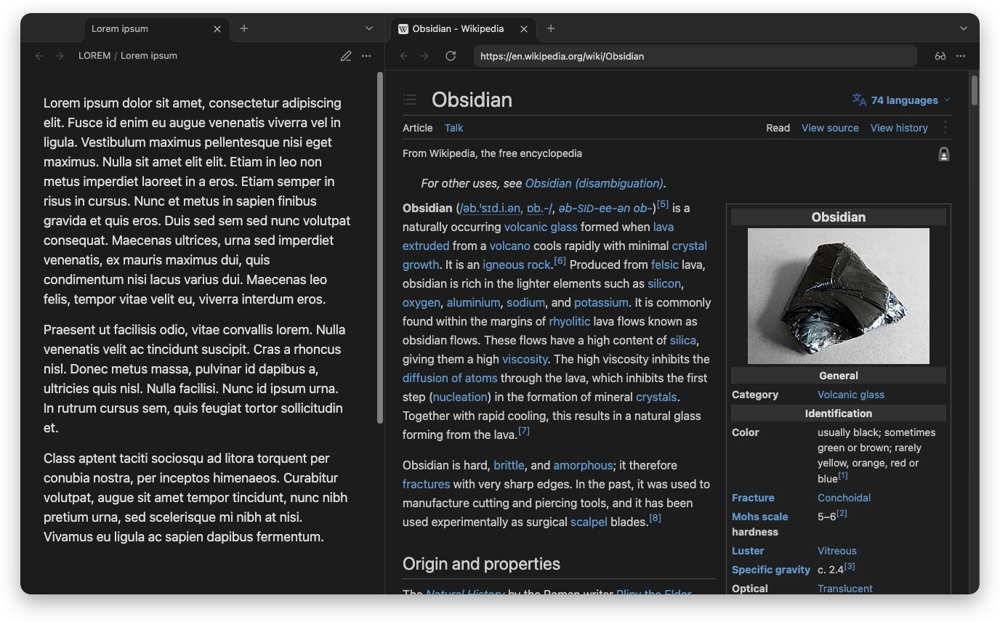
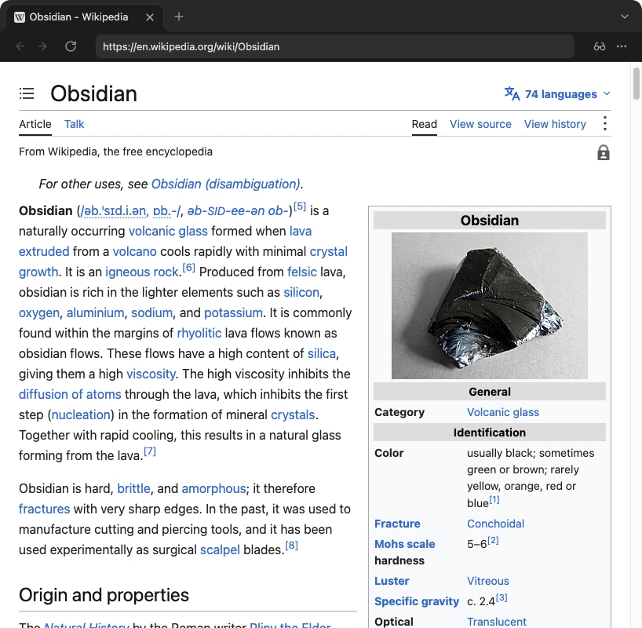
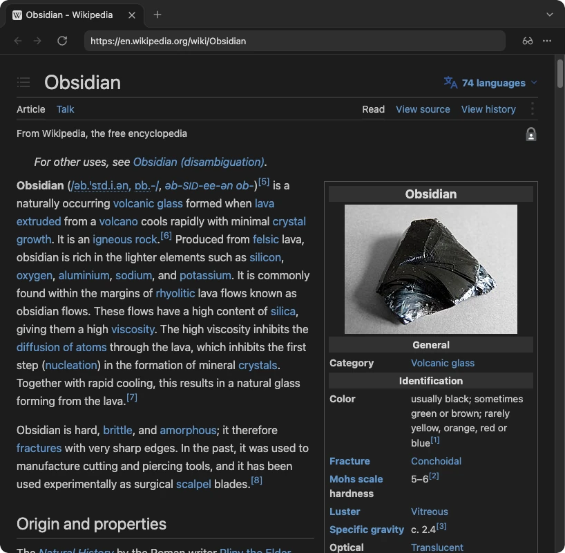
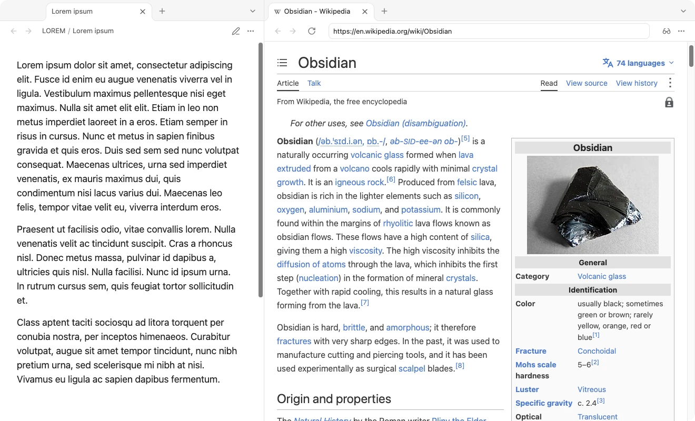
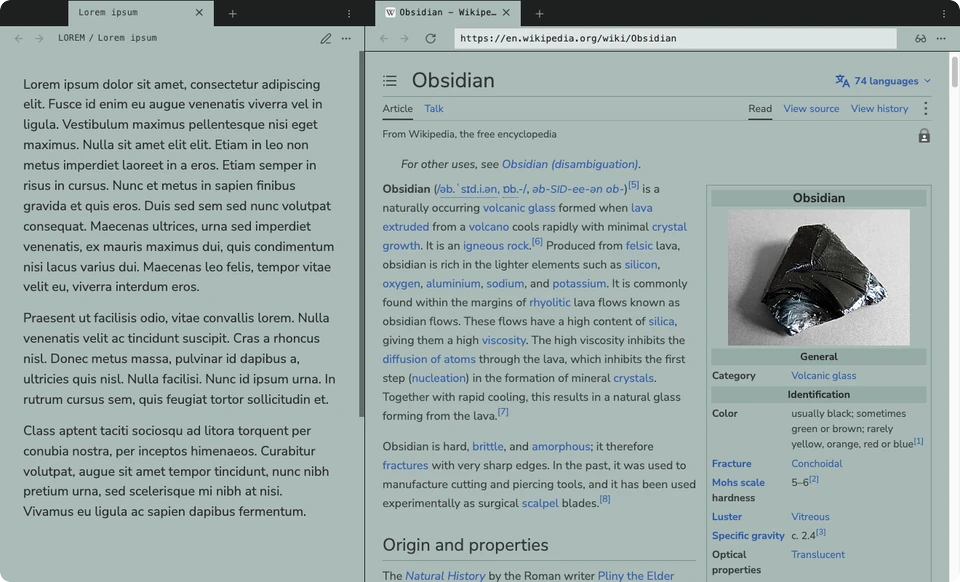
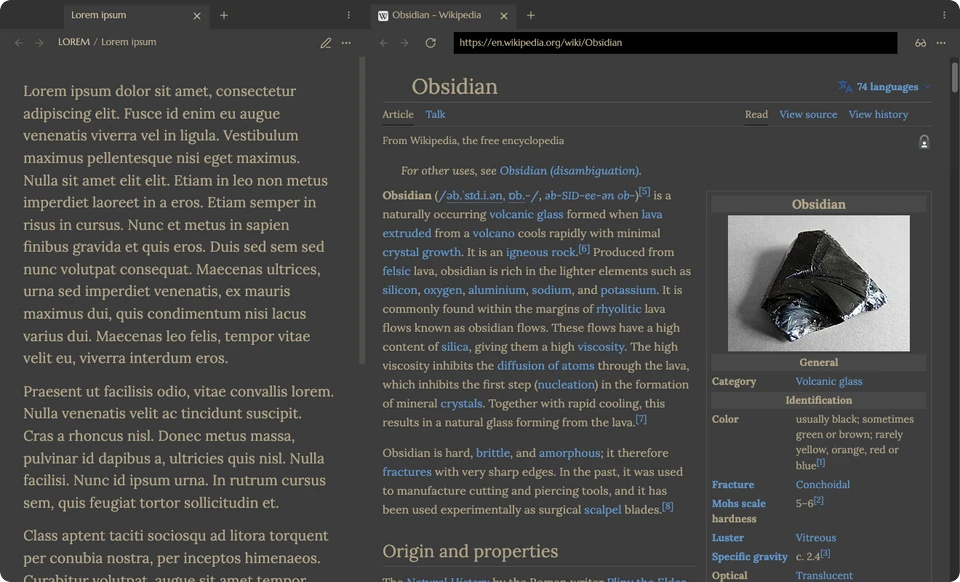
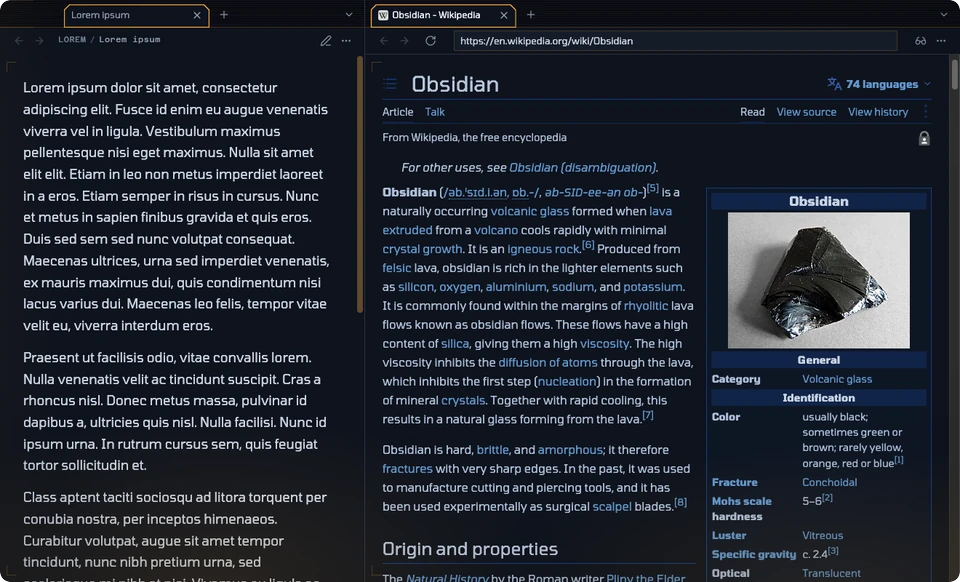
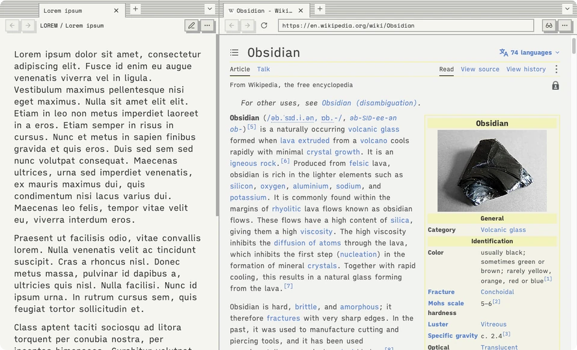
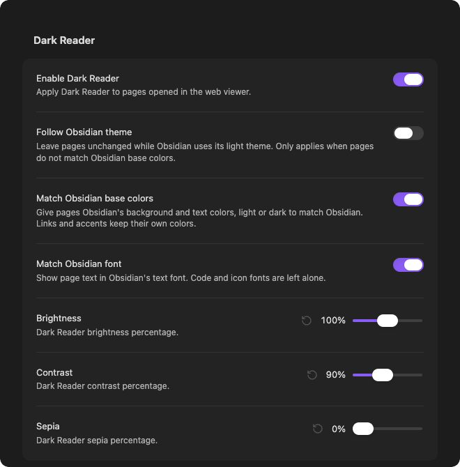

<div align="center">

# Dark Reader for Web Viewer

**Read the web in your Obsidian theme.**

[Dark Reader](https://github.com/darkreader/darkreader) for Obsidian's built-in Web viewer.<br>
Web pages take your theme's background, text color and font, in dark mode and in light.




</div>

## Contents

- [Features](#features)
- [See it in action](#see-it-in-action)
- [Installation](#installation)
- [Settings](#settings)
- [Commands](#commands)
- [How it works](#how-it-works)
- [Known limitations](#known-limitations)
- [Development](#development)
- [License](#license)

## Features

- **Matches your theme exactly.** A page's background and text become your theme's own `--background-primary` and `--text-normal`. Links, buttons and accents keep their colors, so pages stay readable.
- **Dark and light.** Pages follow Obsidian as you switch between light and dark, change themes or toggle CSS snippets. No reload needed.
- **Your font, too.** Optionally shows pages in your theme's text font, even when the theme embeds that font itself.
- **No white flash.** Pages are painted in your colors from the moment they start loading, not after.
- **Every Web viewer tab**, including tabs in popout windows, and after every navigation.
- **Fine-tuning.** Brightness, contrast and sepia, like the browser extension.
- **Private and offline.** Dark Reader is bundled with the plugin. Nothing is downloaded while it runs.

## See it in action

### Before and after

| Without the plugin | With the plugin |
| :---: | :---: |
|  |  |

### Light mode

When Obsidian is light, pages take your theme's light colors instead.



### Any theme, its colors and its font

Each page below uses the theme's own background, text color and text font, with **Match Obsidian font** on.

| Halftone, light | Brutalist, dark |
| :---: | :---: |
|  |  |
| *Nunito Sans, embedded in the theme* | *Lora* |
| **Blade Runner, dark** | **Aubade, light** |
|  |  |
| *Tomorrow* | *iA Writer Quattro* |

## Installation

> [!IMPORTANT]
> This plugin needs Obsidian **1.8.3 or newer** on desktop, with the **Web viewer** core plugin turned on: **Settings → Core plugins → Web viewer**. It does not run on mobile, because it relies on the desktop app's `<webview>`.

### Manual installation

1. Download **`main.js`** and **`manifest.json`** from this repository, or from a release when one is available.
2. In your vault, create the folder `.obsidian/plugins/dark-reader-web-viewer/`.
3. Put both files in that folder.
4. Restart Obsidian, or reload it from the command palette.
5. Turn on **Dark Reader for Web Viewer** in **Settings → Community plugins**.

Open any page in a Web viewer tab, and it follows your theme.

### Build from source

```sh
git clone https://github.com/DuckTapeKiller/dark-reader-web-viewer.git
cd dark-reader-web-viewer
npm install
npm run build
```

Then copy `main.js` and `manifest.json` into your vault as above.

## Settings



| Setting | Default | What it does |
| --- | :---: | --- |
| **Enable Dark Reader** | On | Turns page theming on or off. |
| **Follow Obsidian theme** | Off | Leaves pages unchanged while Obsidian is light. Only applies when **Match Obsidian base colors** is off. |
| **Match Obsidian base colors** | On | Gives pages your theme's background and text colors, light or dark to match Obsidian. |
| **Match Obsidian font** | Off | Shows page text in your theme's text font. Code and icon fonts are left alone. |
| **Brightness** | 100% | Dark Reader's brightness. |
| **Contrast** | 90% | Dark Reader's contrast. |
| **Sepia** | 0% | Dark Reader's sepia tint. |

### What pages look like

| Obsidian is… | Match Obsidian base colors | Follow Obsidian theme | Pages are… |
| --- | :---: | :---: | --- |
| Dark | On | any | Dark, in your theme's colors |
| Light | On | any | Light, in your theme's colors |
| Dark | Off | any | Dark, in Dark Reader's own colors |
| Light | Off | Off | Dark, in Dark Reader's own colors |
| Light | Off | On | Unchanged |

## Commands

| Command | What it does |
| --- | --- |
| **Toggle web viewer dark mode** | Turns page theming on or off. |
| **Reapply web viewer dark mode** | Reinstalls Dark Reader in every open page, in case a site misbehaves. |

## How it works

The plugin bundles [Dark Reader's public API](https://www.npmjs.com/package/darkreader) and installs it into each page opened in Obsidian's Web viewer. It does not need the browser extension.

<details>
<summary><b>The details</b></summary>

<br>

- **Installing.** The plugin watches for Web viewer tabs and uses `webview.executeJavaScript()` to install Dark Reader in each page. Before every update it asks the page whether it already runs this build's copy. Navigation, reloads, in-page links and plugin updates are therefore all handled the same way. Updates to a page run one at a time, and the latest settings always win.
- **No white flash.** Electron holds `executeJavaScript()` until a page has finished loading, images included. `webview.insertCSS()` is not held back, so the plugin paints each new page in the target colors as soon as it starts loading. It removes that style once Dark Reader is running.
- **Exact colors.** Obsidian's colors are passed to Dark Reader as its scheme colors. Dark Reader turns a page's white background and black text into those colors, then applies brightness, contrast and sepia. The plugin hands it colors with that filter already undone, so the result matches Obsidian.
- **Fonts.** **Match Obsidian font** sets your text font with a constructed stylesheet. A theme that embeds its font as a data URL has that font recreated in the page with the `FontFace` API. Such fonts are sent once per page, and they load even on sites whose content security policy blocks web fonts.
- **Offline.** The bundled injector is built from the `darkreader` package. No third-party script is fetched at run time.

</details>

## Known limitations

- **Images are left as they are.** Dark Reader does not recolor images, so a dark logo on a dark page can be hard to see. The browser extension fixes some sites with its own per-site rules, which this plugin does not include.
- **Low contrast lifts the darkest colors.** Below about 80% contrast, Dark Reader cannot make colors as dark as a very dark theme, so backgrounds or black text come out a little lighter. Bright colors are compensated at any contrast. Brightness below 100% dims pages below your theme's colors, as you would expect.
- **Fonts** must be installed on your system or embedded in the theme. Pages cannot reach the fonts Obsidian ships inside the app, so the next font in your theme's list is used instead.
- **Web viewer only.** Markdown previews, Canvas and other embedded pages are not affected.
- **Internal API.** The Web viewer's internals are not a public plugin API, so a future Obsidian update may need a plugin update.

## Development

```sh
npm install
npm run dev      # rebuild on every change
npm run build    # lint, type-check and bundle into main.js
```

Every build runs the official [Obsidian ESLint plugin](https://github.com/obsidianmd/eslint-plugin) first, over the TypeScript sources, the build scripts and `package.json`. Any warning fails the build. `npm run update:lint` moves the lint toolchain to its latest versions.

`src/generated-injector.ts` is written by `esbuild.config.mjs` during the build. Don't edit it by hand.

## License

[MIT](LICENSE). Dark Reader is included under its own MIT license; see [`THIRD-PARTY-NOTICES.md`](THIRD-PARTY-NOTICES.md). This plugin is not affiliated with Dark Reader Ltd.
